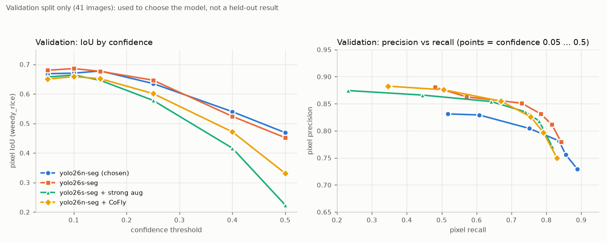
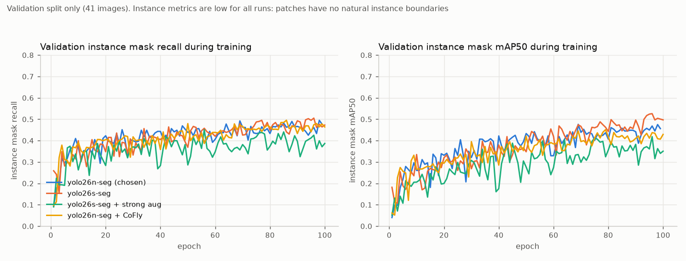
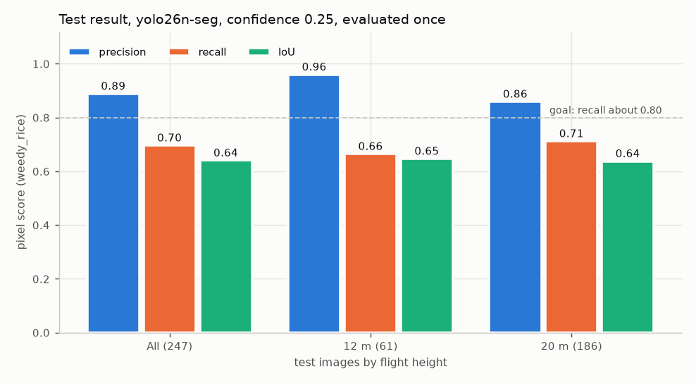

# The four trained models

All four were trained on the same data (WeedyRice-RGBMS-DB, train split) with the same settings
unless noted, and compared on the **validation split** (41 images, one date, 2024-09-30).
Validation was used to choose the model, so these numbers are **for comparing models only, not a
held-out result**. Only the chosen model was evaluated on the test split, once.

Pixel scores: union of predicted masks against the label mask, class `weedy_rice` only,
recall always shown next to precision. Charts contain numbers only, no dataset images.

## Results per model

| Model | Role | Train time | Params | Best val IoU (conf) | Val pixel precision / recall / IoU at 0.25 | Val instance precision / recall / mAP50 / mAP50-95 | Test |
|---|---|---|---|---|---|---|---|
| `yolo26n-seg` | **Chosen** | 50 min | about 2.7 M | 0.678 (0.15) | 0.804 / 0.751 / 0.635 | 0.517 / 0.486 / 0.473 / 0.196 | 0.889 / 0.697 / 0.641 (precision / recall / IoU) |
| `yolo26s-seg` | Optional | 79 min | about 10.4 M | 0.686 (0.10) | 0.851 / 0.729 / 0.646 | 0.602 / 0.503 / 0.519 / 0.199 | not evaluated |
| `yolo26s-seg` + strong augmentation | Optional | 100 min | about 10.4 M | 0.664 (0.10) | 0.854 / 0.641 / 0.578 | 0.511 / 0.436 / 0.407 / 0.155 | not evaluated |
| `yolo26n-seg` + CoFly-WeedDB | Optional | 69 min | about 2.7 M | 0.659 (0.10) | 0.855 / 0.669 / 0.601 | 0.493 / 0.474 / 0.453 / 0.182 | not evaluated |

Train time is on one RTX 2080 SUPER. Settings: image size 1280, 100 epochs configured (the chosen
run's log has 99 rows), seed 0. Batch 3 for the nano models and 2 for the small ones (batch 3 filled
the 8 GB of VRAM). Full per-confidence tables: [`results/val_comparison.json`](results/val_comparison.json).

The only publishable result (test split, chosen model, evaluated once):

## What each model is

**`yolo26n-seg` (chosen).** Ultralytics YOLO26 nano, segmentation, one class `weedy_rice`. Config
`configs/train.yaml`. Smallest and fastest, and not worse than the others on validation, so it was kept.
Files and test result: [release v1.0.0](https://github.com/Putinun-te/rice-weed-detection/releases/tag/v1.0.0).

**`yolo26s-seg`.** Same recipe with the larger small model. Config `configs/train_s.yaml`. Slightly
higher validation IoU (0.686 vs 0.678) and precision, slightly lower recall at conf 0.25. The 0.008 IoU gap
is inside the noise of a 41-image split and costs four times the parameters and 60% more training time.

**`yolo26s-seg` + strong augmentation.** As above with `scale 0.7, hsv_v 0.5, hsv_s 0.8` (stronger than the
defaults). Config `configs/train_s_aug.yaml`. Worse on validation (best IoU 0.664, recall 0.641 at 0.25) and its
validation curves are the noisiest. The augmentation did not help.

**`yolo26n-seg` + CoFly-WeedDB.** 201 cotton-field UAV images (other weed species) added to train as a second class
`other_weed`; validation and test are unchanged. Config `configs/train_cofly.yaml`. Recall dropped at every
confidence (0.669 vs 0.751 at 0.25), so extra data from another crop did not help. **This model has two classes:**
filter on `weedy_rice` and ignore `other_weed` (`rwd.evaluate` and `rwd.infer` report the class name).

## Reading the numbers

- All four are within a few points of each other on 41 images from one date. None is clearly better than
  `yolo26n-seg`; the strong-augmentation run is clearly worse.
- Instance metrics (mAP) are low for every model because weedy-rice patches have no natural instance
  boundaries, so pixel scores are the headline. Test instance mAP50 of the chosen model is 0.181.
- For the chosen model the pixel scores on validation and test are similar (IoU 0.635 vs 0.641 at 0.25),
  but instance mAP50 falls from 0.473 to 0.181 on test: the test site has denser, more fragmented patches.
- The three optional models were **not** evaluated on test. Doing so now would be a second look at a split
  that is meant to be used once; if it is done, label it as a second look.

## Files

| Model | Where |
|---|---|
| `yolo26n-seg` (chosen), PyTorch / ONNX / NCNN | [release v1.0.0](https://github.com/Putinun-te/rice-weed-detection/releases/tag/v1.0.0) |
| The three optional models, PyTorch only | [release optional-models-2026-11-13](https://github.com/Putinun-te/rice-weed-detection/releases/tag/optional-models-2026-11-13) |

The release copies have the same weights as the trained files. Local file paths were removed from their metadata.

## Data credit

- **WeedyRice-RGBMS-DB** (all four models; CC BY 4.0): Nguyen, V. H., Le, C.-D., Truong, M.-T., Bui, M.-P., Le, T.-P. (2025).
  *WeedyRice-RGBMS-DB: A dataset of aligned RGB and multispectral UAV imagery for semantic segmentation of weedy rice.*
  Mendeley Data, V1, doi:[10.17632/vt4s83pxx6.1](https://doi.org/10.17632/vt4s83pxx6.1);
  Data in Brief, doi:[10.1016/j.dib.2025.112237](https://doi.org/10.1016/j.dib.2025.112237).
- **CoFly-WeedDB** (the CoFly model only; CC BY 4.0): Krestenitis, M., Raptis, E. K., Kapoutsis, A. Ch., Ioannidis, K.,
  Kosmatopoulos, E. B., Vrochidis, S., Kompatsiaris, I. (2022). *CoFly-WeedDB: A UAV image dataset for weed detection and
  species identification.* Zenodo, doi:[10.5281/zenodo.6697343](https://doi.org/10.5281/zenodo.6697343);
  Data in Brief 45:108575, doi:[10.1016/j.dib.2022.108575](https://doi.org/10.1016/j.dib.2022.108575).

Both datasets are third-party work and are not part of this repository. Full records: [`../DATASET.md`](../DATASET.md).

Regenerate the JSON and charts with `.venv/bin/python scripts/make_model_report.py` (needs the `runs/` folders).
